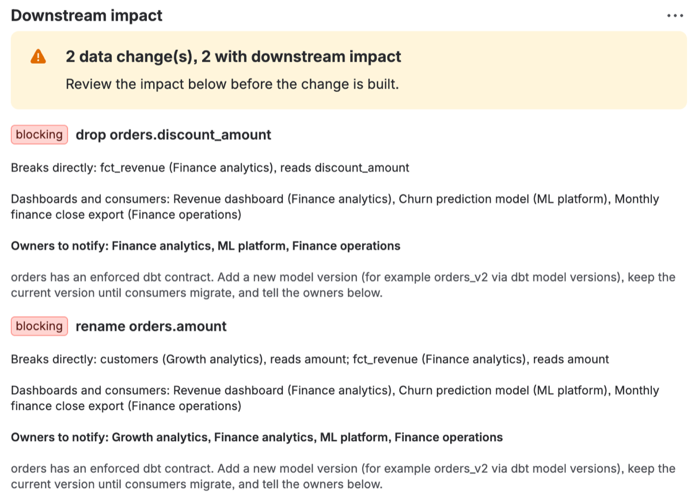
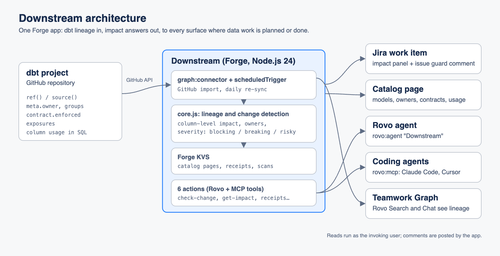

# Downstream

**Know what a data change breaks before it ships.**

Data teams plan dbt work in Jira, and more and more of it is now written by AI coding
agents. A ticket says "drop discount_amount from orders" or "rename amount to gross_amount".
Nothing in the ticket says that `fct_revenue` reads that column, that the Monday revenue
dashboard and the churn model sit on top of it, that `orders` has an enforced dbt contract,
or that three teams own those consumers. The agent edits the SQL, the build or the dashboard
breaks, and the owners hear about it last.

Downstream puts dbt lineage where the work is planned:

- **Impact in the ticket.** Every Jira work item shows the models, sources and columns it
  proposes to change, what each change breaks downstream (down to the column), the
  dashboards and ML models it feeds, and the owners to notify.
- **Plans checked before SQL is edited.** A coding agent calls `check-change` with its plan.
  Changes to contracted models are blocking, breaking changes list what breaks, and the
  agent gets concrete advice (version the model, update downstream models, notify owners).
- **Receipts after.** When the work is done, the agent posts a data change receipt: what
  changed, who was notified, tests and the PR. Downstream lists affected owners nobody told.



## Where it shows up

| Surface | What it does |
| --- | --- |
| **Rovo agent "Downstream"** | "What breaks if we do DATA-42?", "Who owns orders?", "Which dashboards use fct_revenue?", "Check my plan". |
| **MCP tools** (`rovo:mcp`) | The same six tools for Claude Code, Cursor or Rovo Studio agents. [skills/downstream/SKILL.md](skills/downstream/SKILL.md) is a drop-in agent skill. |
| **Jira issue panel** | Each detected change with severity, what breaks, consumers, owners and advice; receipts; owners not notified yet. |
| **Catalog page** (Jira Apps) | Every model, source and exposure with owner, contract and usage; one click loads a sample dbt project. |
| **Issue guard** (trigger) | When a work item is created or edited, Downstream comments once per newly detected risky change. |
| **Teamwork Graph connector** | Imports a dbt project from GitHub: models and sources as documents linked to the models they read from, dashboards as dashboard objects, so Rovo Search and Chat see the lineage. Re-synced daily. |

### Tools (Rovo actions and MCP)

| Tool | Verb | Purpose |
| --- | --- | --- |
| `get-ticket-impact` | GET | Data changes a work item proposes and their downstream impact. |
| `check-change` | GET | Check a change plan before editing SQL; `ok` is false for blocking or breaking changes. |
| `get-impact` | GET | Everything downstream of a model, source or single column. |
| `describe-asset` | GET | Owner, contract, columns, inputs and consumers of an asset. |
| `find-assets` | GET | Search by name, owner, description or column. |
| `submit-change-receipt` | CREATE | Post a receipt on a work item and report affected owners not notified. |

## How it works

The connector reads `dbt_project.yml`, every model's SQL and every properties YAML file:

- **Lineage** from `ref()` and `source()` calls.
- **Column usage**: a model reads an upstream column when its SQL names it; a model whose
  final statement is `select *` passes every column through.
- **Owners** from `meta.owner`, `config.meta.owner`, the model's group, or the exposure's owner.
- **Contracts** from `config.contract.enforced`.
- **Consumers** from `exposures` (dashboards, ML models, applications) and their `depends_on`.

Change detection reads the work item or plan clause by clause, pairs each column with the
nearest operation (drop, rename, type change, logic change), ignores negated ones ("do not
drop order_id"), and only treats plain-word model names such as `orders` as references when
the text says so ("the orders model", `` `orders` ``, `orders.amount`). Severity:

| Severity | Rule |
| --- | --- |
| blocking | drop, rename or type change on a model with an enforced contract |
| breaking | drop, rename or type change that something downstream reads |
| risky | a logic change (grain, filters, definitions) with consumers |
| safe | nothing downstream reads it |

Everything is deterministic and explainable: each impact says why ("reads discount_amount").

## Try it

```bash
npm install
npm test                      # 36 unit tests, no Forge needed
forge login
forge register
forge deploy
forge install --product jira --site <your-site>.atlassian.net
```

Open **Apps > Downstream** and click **Load sample dbt project**. Under **Try it**, pick a
project and click **Create demo work item**: it files *"Clean up the orders model"* ("Drop
discount_amount and rename amount to gross_amount"). Open it and add the **Downstream impact**
panel from the apps button under the title: both changes are blocking because `orders` has an
enforced contract. Edit the work item and the issue guard posts the same warning as a comment.

To connect a real project, an admin adds the **dbt** connector from Downstream in Atlassian
Administration with `owner/repo`, the project folder (for this repository's sample:
`examples/jaffle_shop`), the branch and, for private repositories only, a read-only token.

To use the tools from an external MCP client, a site admin enables them under **Atlassian
Administration > Apps > Sites > your site > Connected apps > Downstream**; the client then adds
`https://mcp.atlassian.com/forge/<appId>`.

## Architecture



```
src/core.js       pure logic: dbt parsing, lineage, change detection, severity, renderers
src/service.js    use cases shared by every surface (storage and Jira injected)
src/index.js      Forge entry points: actions, resolvers, issue trigger
src/connector.js  Teamwork Graph connector: GitHub dbt import and graph ingestion
src/store.js      Forge KVS persistence (catalog pages, receipts, scans, connections)
src/jira.js       Jira REST adapter
src/demo.js       the sample jaffle shop project (also in examples/jaffle_shop)
src/frontend/     UI Kit issue panel and catalog page
```

## Data and permissions

- The dbt catalog, receipts and scan results are stored in Forge storage inside your site.
- Reads run as the invoking user, so agents only see work items their user can see.
  Comments are posted by the app.
- The only egress is to GitHub (`api.github.com` and `raw.githubusercontent.com`), and only when an admin configures the connector.
  The optional token is stored as a Forge secret and never returned.
- Scopes: `read:jira-work`, `write:jira-work`, `storage:app`, and the Teamwork Graph object
  scopes required by connectors.

## License

MIT
